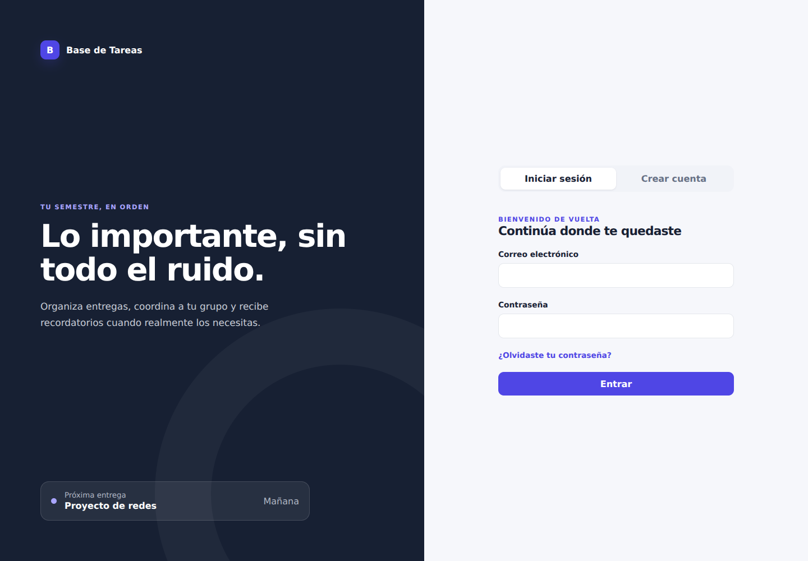

# Base de Tareas

Aplicación web colaborativa para organizar materias, tareas, anuncios y recordatorios escolares dentro de grupos privados.

**Versión actual:** 2.6.2

**Aplicación:** [basedetareas.vercel.app](https://basedetareas.vercel.app)

Base de Tareas utiliza una SPA ligera en el navegador, una API con Express desplegada en Vercel, Turso como base de datos, Resend para los correos y QStash para programar notificaciones push personales. La misma aplicación puede ejecutarse localmente sin cambiar su arquitectura.

## Vista de la aplicación



Vista local de la interfaz de acceso, servida estáticamente con una respuesta de sesión no autenticada simulada; no conecta una base de datos ni contiene datos de usuarios.

## Funciones principales

### Cuentas y seguridad

- Registro mediante correo, nombre y contraseña.
- Verificación obligatoria con un código de seis dígitos antes de crear la cuenta.
- Códigos con diez minutos de vigencia, máximo de cinco intentos y reenvío cada 60 segundos.
- Recuperación de contraseña mediante un código enviado por correo.
- Cierre de las sesiones anteriores después de cambiar la contraseña.
- Contraseñas protegidas con bcrypt y sesiones firmadas en cookies `HttpOnly`.
- Límites de solicitudes en las rutas de autenticación.

### Grupos y roles

- Creación de grupos privados con código de invitación.
- Posibilidad de pertenecer y cambiar entre varios grupos.
- Opción para abandonar un grupo cuando el usuario lo desee.
- Protección del último administrador: debe transferir su función antes de salir.
- Separación estricta de materias, tareas, anuncios y miembros entre grupos.

| Rol | Capacidades principales |
| --- | --- |
| Administrador | Gestiona el grupo, integrantes, roles, materias y tareas. |
| Gestor | Organiza materias y tareas sin poder modificar administradores. |
| Alumno | Consulta, completa, comenta y configura recordatorios personales. |

Nadie puede seleccionar un rol privilegiado durante el registro. La persona que crea el grupo se convierte en su primer administrador y puede asignar funciones desde **Equipo**.

### Materias y tareas

- Materias con clave, profesor, aula, horario, color, temas y unidades.
- Tarjetas de materias con gradientes derivados del color elegido y detalles expandibles.
- Edición separada en el menú de tres puntos para evitar cambios accidentales al consultar una materia.
- Unidades y temas colapsables que muestran sus tareas únicamente después de seleccionarlos.
- Tareas con descripción, fecha de entrega, prioridad y tema relacionado.
- Pasos o subtareas con progreso independiente por usuario.
- Comentarios dentro de cada tarea.
- Enlaces adjuntos con validación de protocolos seguros.
- Marcado individual de tareas y subtareas como completadas.
- Búsqueda global, filtros por materia y estado, y marcado de tareas importantes.
- Dashboard, lista de tareas y calendario.
- Edición, eliminación recuperable y restauración.
- Borrado permanente de tareas desde la papelera.

### Anuncios y recordatorios

- Publicación de anuncios independientes de las tareas.
- Fecha opcional para mostrar el anuncio en el calendario.
- Recordatorios personales de anuncios por correo.
- Avisos por correo cuando se agrega una tarea nueva.
- Recordatorio automático para tareas pendientes próximas a vencer.
- Recordatorios personales programados para la fecha y hora elegidas.
- Cancelación local y en Resend cuando se elimina un recordatorio.
- Cola automática para recordatorios que todavía están fuera de la ventana de programación de Resend.
- Notificaciones push opcionales para tareas nuevas, anuncios y entregas próximas.
- Compatibilidad con la PWA instalada en iPhone, iPad y Android.
- Centro personal de recordatorios con texto libre y cola cronológica.
- Vínculo opcional con una tarea, anuncio o evento del grupo.
- Elección independiente entre correo, push o ambos medios.
- Edición y eliminación con cancelación de los envíos programados anteriores.
- Entrega push a la hora elegida mediante mensajes firmados de QStash.

### Experiencia y personalización

- Dashboard con progreso personal, próximas entregas y actividad reciente.
- Historial que identifica a la persona que realizó cada cambio.
- Calendario mensual y agenda optimizada para celulares.
- Interfaz responsiva con navegación móvil, menús colapsables y diálogos adaptados.
- Tema claro, oscuro o automático.
- Color principal personalizable por usuario.
- Foto de perfil o avatar con iniciales y color personalizado.
- Preferencias de zona horaria y notificaciones por correo.
- Exportaciones en CSV, ICS y JSON.
- Aplicación web instalable mediante PWA.

## Tecnologías

| Área | Tecnología |
| --- | --- |
| Interfaz | HTML, CSS y JavaScript sin framework |
| Servidor | Node.js 22 y Express 5 |
| Base de datos | Turso y LibSQL/SQLite |
| Validación | Zod |
| Autenticación | bcrypt, JWT y cookies seguras |
| Correos | Resend |
| Programación push | Upstash QStash |
| Hosting | Vercel Functions |
| Pruebas | Vitest, Supertest, Happy DOM y Playwright |

## Estructura del proyecto

```text
BaseDeTareas/
├── README.md
└── base-de-tareas/
    ├── api/index.js              # entrada serverless de Vercel
    ├── database/schema.sql       # esquema idempotente para Turso/LibSQL
    ├── docs/architecture.md      # decisiones de seguridad y arquitectura
    ├── public/                   # interfaz, estilos, manifiesto y service worker
    ├── scripts/migrate.mjs       # aplica y comprueba las migraciones
    ├── scripts/smoke-production.mjs
    ├── src/server/               # API, autenticación, permisos, correo y cron
    ├── test/                     # pruebas de API, interfaz y navegador
    ├── server.js                 # servidor para desarrollo local
    └── vercel.json               # Function, rutas y cron diario
```

## Requisitos

- Node.js 22 o superior.
- Una base de datos Turso o un archivo LibSQL local.
- Una clave JWT de al menos 32 caracteres.
- Una cuenta de Resend con dominio verificado para las funciones de correo.
- Una cuenta gratuita de Upstash QStash para los recordatorios push con hora exacta.

## Instalación local

```bash
git clone https://github.com/DonMilo-22/BaseDeTareas.git
cd BaseDeTareas/base-de-tareas
npm ci
cp .env.example .env
```

Completa las variables de `.env`, aplica el esquema y arranca el servidor:

```bash
npm run migrate
npm run dev
```

Abre [http://localhost:3000](http://localhost:3000).

Para trabajar sin Turso puedes usar una base local:

```env
TURSO_DATABASE_URL=file:./database/local.db
TURSO_AUTH_TOKEN=
```

## Configuración y despliegue

Consulta la [guía de configuración](docs/configuracion.md) para las variables de entorno, Turso, Resend, VAPID, QStash y Vercel.

## Pruebas

```bash
npm run check        # sintaxis y pruebas automatizadas
npm run test         # Vitest
npm run test:watch   # Vitest en modo interactivo
npm run test:e2e     # recorridos de escritorio y móvil con Playwright
npm run smoke        # comprobación de un despliegue
npm audit --omit=dev
```

La versión 2.6.2 cuenta con pruebas para registro verificado, recuperación de contraseña, aislamiento entre grupos, permisos, materias expandibles, suscripciones push, recordatorios personales por correo y push, firmas de QStash resistentes a rewrites de Vercel, diagnóstico seguro, programación diferida, edición, cancelación, anuncios, papelera, exportaciones e interfaz móvil.

## Seguridad

- Todas las autorizaciones se validan en el servidor.
- Las entradas se validan con Zod y las mutaciones verifican el origen de la petición.
- Los códigos de correo se almacenan como HMAC, nunca en texto visible.
- Las contraseñas se almacenan con bcrypt.
- Las sesiones usan cookies `HttpOnly`, `SameSite=Lax` y `Secure` en producción.
- El JWT contiene solamente el identificador del usuario y la versión de su sesión.
- Los grupos están aislados y cada operación comprueba pertenencia y rol.
- Las entregas de QStash se aceptan únicamente con firma válida y cada push programado es idempotente.
- No se almacenan archivos adjuntos: únicamente metadatos y enlaces HTTP/HTTPS validados.

Más detalles en [`base-de-tareas/docs/architecture.md`](base-de-tareas/docs/architecture.md).

## Licencia

Desarrollado por [DonMilo-22](https://github.com/DonMilo-22). Este proyecto utiliza la licencia MIT.
